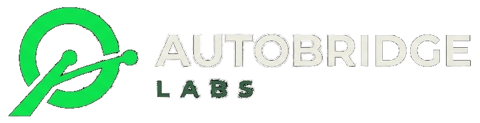

<p align="center">
  
</p>

# AutoBridge (`autobridge`)

> **The Mathematical Guarantee of Automotive Supply Chain Delivery.**  
> Zero-dependency ANSI X12 856 (Advance Ship Notice) AST parser, deterministic auto-repair firewall, and Driver Dock Clearance Certificate engine for Ford AIAG B-10, GM 1724, and Stellantis OEM receiving docks.

[](https://github.com/gana04982-ship-it/autobridge/actions/workflows/ci.yml)
[](https://github.com/gana04982-ship-it/autobridge/actions/workflows/deploy-pages.yml)
[](https://gana04982-ship-it.github.io/autobridge/)
[](ui/pricing.html)
[](tests/)
[]()
[](ui/security.html)
[](LICENSE)

---

## 🎯 The Industrial Problem

Automotive parts manufacturers (Tier-1 and Tier-2 suppliers) operate on razor-thin 3%–6% margins. Every shipment leaving a supplier's loading dock must be accompanied by an electronic **EDI 856 Advance Ship Notice (ASN)** transmitted over AS2 networks.

When an 18-wheeler truck arrives at an OEM assembly plant (e.g. Ford Dearborn, GM Arlington, Stellantis SHAP):
* Automated overhead dock scanners read pallet 2D DataMatrix barcodes and compare them against the received EDI 856 stream.
* If a single qualifier is mismatched (e.g. `LIN02` is `ZZ` instead of `BP`), if the pallet packaging count in `TD102` drifts from actual tare loops, if Bill of Lading (`REF*BM`) is missing, or if timestamps are inverted:
* **The OEM automated receiving system rejects the delivery and levies a $5,000 to $15,000 chargeback fine per incident**, deducting it directly from the supplier's payment invoice.

Legacy EDI Value-Added Networks (VANs) like SPS Commerce and OpenText act as passive post offices: they disclaim all chargeback liability and transmit invalid files without semantic inspection.

**AutoBridge is the pre-flight firewall that catches and auto-repairs dock traps before the truck releases from the supplier's gate.**

---

## 🏛️ Architecture: 4-Tier Verification & Auto-Repair Pipeline

AutoBridge processes EDI streams through a deterministic, four-stage validation and repair pipeline in **sub-millisecond time (<0.5ms)**:

```
Raw ANSI X12 Stream
        │
        ▼
[Tier 1: Dynamic Delimiter Extractor]
  Extracts element, component, and segment terminators from ISA header bytes 3, 104, 105.
        │
        ▼
[Tier 2: Envelope Integrity Validator]
  Validates ISA/IEA control numbers, GS/GE group tallies, and exact ST/SE segment counts (SE01).
        │
        ▼
[Tier 3: Stateful HL Graph Tree-Builder]
  Reconstructs parent-child topological loops: Shipment (S) -> Order (O) -> Tare (T) -> Pack (P) -> Item (I).
        │
        ▼
[Tier 4: OEM Semantic Dock Rules (Ford AIAG B-10 / GM 1724 / Stellantis DESADV)]
  Cross-checks pallet tallies, gross weights, carrier SCAC codes, BOL presence, and barcode uniqueness.
        │
        ├──▶ AuditReport (Green "Certified Safe to Ship" OR Actionable Remediation Audit)
        ├──▶ AutoRepairEngine (In-memory deterministic AST auto-fix + SE01 recalculation)
        └──▶ Driver Dock Clearance Certificate (Cryptographic SHA-256 seal for truck clipboard)
```

---

## 💻 3-Page Industrial Web Application (`ui/`)

AutoBridge includes an enterprise web suite running locally or statically in any browser:

1. **Landing Page (`ui/index.html`)**: Interactive dock fine exposure calculator, architecture walkthrough, and live terminal simulation.
2. **Pre-Flight Inspector Studio (`ui/inspector.html`)**: Drag-and-drop EDI file ingestion, line-by-line diff inspector, plain-English dock fine explanation, and 1-click **Auto-Fix All** repair button.
3. **BOL Dock Clearance Certificate (`ui/certificate.html`)**: Print-ready 8.5" × 11" driver certificate stamped with plant delivery details, reconciled segment badges, and cryptographic SHA-256 verification hash to staple to the driver's clipboard.

---

## 🚀 Quickstart & CLI Usage

AutoBridge has **zero external dependencies** and runs on Python 3.9+.

### 1. Scan a Production ASN File
```bash
python -m autobridge.cli audit samples/ford_clean_shipment.edi --oem FORD-AIAG-B10
```

**Output:**
```text
==============================================================================
    🚀 AUTOBRIDGE PRE-FLIGHT EDI INSPECTOR — DOCK CERTIFICATION
==============================================================================
  Target File:      ford_clean_shipment.edi
  OEM Rule Profile: FORD-AIAG-B10
  Shipment ID:      SHIP12345
  Carrier SCAC:     FXFW | BOL: BOL-987654
  Ship-To Plant:    00123 (FORD DEARBORN TRUCK)
  Pallet Count:     Declared: 1 | In Tree: 1
  Parts Shipped:    100 units across 1 part number(s)
------------------------------------------------------------------------------

  ✅ STATUS: 100% COMPLIANT — CERTIFIED SAFE TO SHIP
  No OEM chargeback violations detected. Ready for dock receiving.

==============================================================================
```

### 2. Detect a Dock Rejection Trap File
```bash
python -m autobridge.cli audit samples/ford_dock_rejection_trap.edi --oem FORD-AIAG-B10
```

**Output:**
```text
==============================================================================
    🚀 AUTOBRIDGE PRE-FLIGHT EDI INSPECTOR — DOCK CERTIFICATION
==============================================================================
  Target File:      ford_dock_rejection_trap.edi
  OEM Rule Profile: FORD-AIAG-B10
  Shipment ID:      SHIP99999
  Carrier SCAC:     FXFW | BOL: UNKNOWN
  Ship-To Plant:    00123 (FORD DEARBORN TRUCK)
  Pallet Count:     Declared: 2 | In Tree: 1
  Parts Shipped:    100 units across 1 part number(s)
------------------------------------------------------------------------------

  🛑 STATUS: DOCK REJECTION RISK — 3 CRITICAL VIOLATION(S)
  Transmitting this file will trigger an automated OEM chargeback fine.

DETAILED VIOLATION AUDIT:
------------------------------------------------------------------------------
1. [FORD-003-MISSING-BOL] Line 5 in segment REF
   Severity: CRITICAL
   Dock Impact: Missing mandatory Bill of Lading number (REF*BM) at Shipment level.
   👉 Remediation Action: Add REF*BM segment with Bill of Lading number under HL*...*S.

2. [FORD-008-PALLET-COUNT-MISMATCH] Line 7 in segment TD1
   Severity: CRITICAL
   Dock Impact: Packaging tally mismatch: TD102 declares 2 pallet(s), but HL tree contains 1 Tare (T) node.
   👉 Remediation Action: Update TD102 from 2 to 1.

3. [FORD-018-INVALID-PART-QUALIFIER] Line 18 in segment LIN
   Severity: CRITICAL
   Dock Impact: LIN02 qualifier must be 'BP' (Buyer's Part Number). Found 'ZZ'.
   👉 Remediation Action: Set LIN02 qualifier to 'BP'.

==============================================================================
```

### 3. 1-Click Deterministic Auto-Repair
```bash
python -m autobridge.cli repair samples/ford_dock_rejection_trap.edi --out clean_shipment.edi
```

**Output:**
```text
==============================================================================
    🛠️ AUTOBRIDGE DETERMINISTIC AUTO-REPAIR ENGINE
==============================================================================
  Source File:      samples/ford_dock_rejection_trap.edi
  OEM Profile:      FORD-AIAG-B10
  Output Target:    clean_shipment.edi
  Total Repairs:    4 applied
------------------------------------------------------------------------------
  1. [LIN] Corrected part qualifier LIN02 from 'ZZ' to mandatory 'BP' (Buyer's Part Number)
  2. [TD1] Synchronized declared packaging count from 2 to match physical 1 Tare pallet node(s)
  3. [REF] Injected mandatory Bill of Lading segment 'REF*BM*BOL-948201-B' under Shipment HL loop
  4. [SE]  Recomputed exact ST-to-SE segment count from 19 to true depth 20
------------------------------------------------------------------------------
  ✅ SHA-256 Digest: 057D49F7E4BA50D31F7BA47D9E53C590B032F96946D9E76C9DFA797E4D245E4F
  ✅ Post-Repair Status: 100% COMPLIANT (0 Violations • $0 Fine Risk)
==============================================================================
```

---

## 🌐 Zero-Dependency HTTP & REST API Server

AutoBridge includes a built-in multi-threaded HTTP server with zero third-party requirements:

```bash
python autobridge/server.py 8085
```

### Endpoints:
* `GET /api/health` — Engine operational status, supported rulesets, server time.
* `GET /api/diagnose` — Full AIAG B-10 & GM 1724 rule and chargeback catalog.
* `POST /api/audit` — Audits raw EDI payload and returns structured JSON violation report.
* `POST /api/repair` — Automatically fixes AST defects and recalculates segment counts.

---

## 🧪 Comprehensive Test Suite (40 Tests Passing in 0.13s)

```bash
python -m unittest discover tests -v
```

Test coverage includes:
* **Delimiter Extraction**: Standard `*`, `~`, non-standard `|`, `^`, composite separators.
* **Envelope Arithmetic**: `ISA13` $\leftrightarrow$ `IEA02`, `GS06` $\leftrightarrow$ `GE02`, exact `SE01` segment counting.
* **HL Graph Loop Hierarchy**: Orphan loop detection, parent ID pointer repairs, cyclic dependency rejection.
* **Packaging Synchronization**: `TD1` tare pallet count reconciliation with physical Tare loops.
* **Semantic Verification**: Buyer part qualifiers (`LIN02=BP`), Bill of Lading (`REF*BM`), timestamp chronological ordering (`DTM 011 < DTM 017`).
* **Idempotency**: Running repair twice produces 100% compliant, bit-for-bit identical output.

---

## 🔒 Enterprise Security, Privacy & Compliance Policies

AutoBridge is designed for automotive Tier-1 and Tier-2 suppliers with strict data governance mandates:

* **[Security Architecture Whitepaper](ui/security.html)**: Details our 100% client-side, in-memory execution model, offline air-gap capabilities, and cryptographic SHA-256 manifest signing.
* **[Automotive Data Privacy Policy](ui/privacy.html)**: Guarantees Zero-Data Retention (ZDR), zero analytics trackers, zero advertising pixels, and strict compliance with GDPR Art. 25 & CCPA.
* **[Enterprise Terms of Service](ui/terms.html)**: Clear commercial terms, AIAG B-10 & GM 1724 deterministic validation scopes, and dock chargeback disclaimers.

---

## 🏢 Corporate Entity & Attribution
AutoBridge Labs is an autonomous industrial systems engineering division of **Sarkaar Groups** ([sarkaargroups.com](https://sarkaargroups.com)).

## 📄 License
Licensed under the [MIT License](LICENSE).
Free for industrial use, plant integration, and evaluation.
